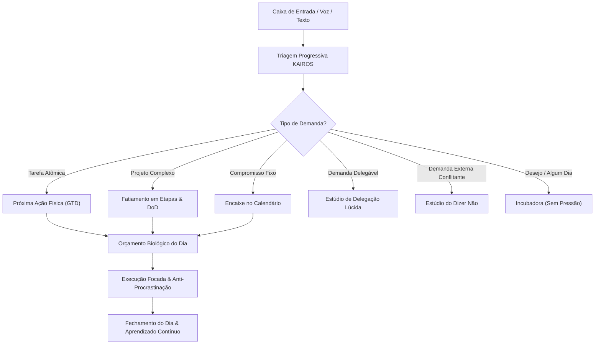
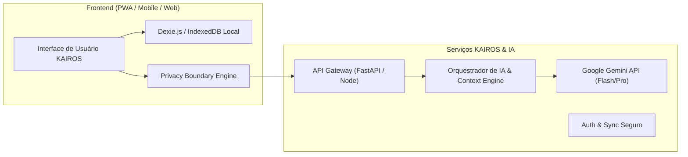
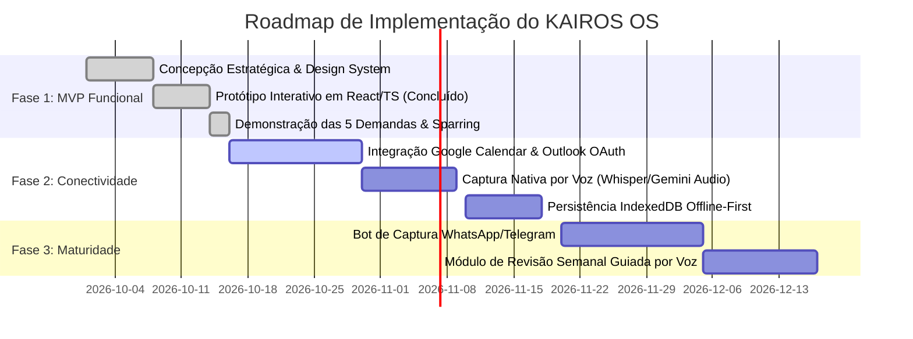

# KAIROS OS: Especificação Estratégica, Arquitetura e Concepção do Produto
## Sistema de Decisão, Priorização, Liderança e Evolução Pessoal com IA Consultiva

---

## Sumário Executivo
Este documento formaliza a visão de produto, arquitetura conceitual e técnica, modelo comportamental e plano de implementação do **KAIROS OS**. 

O produto foi concebido para resolver a **fadiga decisória**, a **ilusão de capacidade infinita** e a **fricção entre esferas da vida** (obrigações executivas, liderança de equipe, rotinas domésticas, estudos e desenvolvimento pessoal). A inteligência artificial não atua como uma secretária submissa nem como um oráculo autocrático, mas como um **sparring partner cognitivo**: uma combinação de consultor de produtividade, coach executivo de liderança, assistente e facilitador de reflexão.

---

## 1. Síntese do Entendimento e Necessidades Centrais

### 1.1 O Diagnóstico do Problema Real
O usuário não sofre de falta de ferramentas para anotar tarefas. O mercado está saturado de gerenciadores de listas (Todoist, TickTick, ClickUp, Asana, Notion, Trello, Jira). O problema real se manifesta em cinco dimensões:

1. **Assimetria e Competição de Atenção:** Demandas de naturezas radicalmente distintas competem pelo mesmo canal de atenção imediata: trocar a dobradiça de uma porta disputa espaço mental com um relatório estratégico da empresa ou o sonho de fazer um mural inspiracional.
2. **Ilusão de Capacidade & Ocupação Tóxica:** A tendência de preencher 100% dos espaços livres do calendário, ignorando que o ser humano tem um limite neurobiológico de trabalho analítico profundo (Deep Work: cerca de 3h a 4h por dia) e que transições de contexto exigem custo cognitivo.
3. **Procrastinação como Sintoma, não como Preguiça:** O adiamento sistemático de tarefas costuma ser motivado por indefinição do primeiro passo físico (tarefa grande ou vaga), medo de avaliação externa, perfeccionismo paralisante ou simples fadiga biológica.
4. **Dificuldade de Dizer Não e Centralização:** Falta de argumentos e assertividade para recusar demandas externas sem atrito político, combinada com a tentação de executar em vez de delegar com critérios claros de aceite.
5. **A Punição do Backlog Acumulado:** Gerenciadores tradicionais punem o usuário que passa duas semanas ausente com centenas de notificações vermelhas de "Atrasado", gerando culpa, vergonha e o consequente abandono do sistema.

### 1.2 Resultados Desejados
* **Clareza de Escolha:** Saber exatamente o que fazer agora, o que pode esperar e o que deve ser ativamente recusado ou renegociado.
* **Preservação de Energia:** Proteger tempo de descanso, família e saúde sem sentimento de culpa.
* **Liderança Autônoma da Equipe:** Delegar com clareza de resultado (Definition of Done) e pontos de checagem previstos, eliminando tanto a delargação irresponsável quanto a microgestão asfixiante.
* **Autonomia Pessoal:** Uma IA que desenvolve a musculatura decisória do usuário, reduzindo gradualmente a dependência da própria ferramenta.

---

## 2. Visão do Produto e Diferenciais Estruturais

* **Nome Conceitual:** **KAIROS OS** *(Do grego Καιρός: o tempo oportuno, qualitativo e supremo da decisão; em contraste com Khronos, o tempo linear e quantitativo do relógio).*
* **Proposta de Valor:** *O primeiro sistema operacional cognitivo que ajuda líderes a discernir o que importa, proteger sua capacidade biológica e agir com tranquilidade.*



### Diferenciais Relevantes:
1. **Curadoria & Sparring Ativo:** A IA discorda fundamentadamente de você. Quando você tenta encaixar uma 6ª hora de reunião ou prioriza uma tarefa burocrática confortável para evitar a conversa difícil com um liderado, a IA aponta o custo de oportunidade.
2. **Orçamento Biológico de Capacidade:** Em vez de assumir que um dia útil possui 8 ou 10 horas de trabalho pleno, o sistema calibra sua agenda com base em limites biológicos reais (máximo de 3h30 de Deep Work analítico) e **blinda obrigatoriamente 25% a 30% de margem livre** para imprevistos e descompressão.
3. **Protocolo "Soft Landing" (Retomada Sem Culpa):** Se você ficar 15 dias sem abrir o sistema, nenhuma luz vermelha piscará. A IA abre uma sessão acolhedora de 3 minutos: arquiva o que caducou, move projetos para a incubadora e reinicia o dia com uma única vitória de tração.
4. **Desconstrução Investigativa da Procrastinação:** Se você adiou a porta do banheiro 4 vezes, o app não envia um 5º alarme. Ele abre um diagnóstico gentil: *É o atrito de buscar a chave de fenda? É falta de sentido? Deseja terceirizar em 2 minutos pelo WhatsApp?*
5. **Simulador de Recusa & Estúdio de Delegação:** Gera respostas assertivas e diplomáticas com base no interlocutor (chefe, cliente, par, familiar) e estrutura delegações com os 3 Níveis de Autonomia de Michael Hyatt.
6. **Memória Transparente & Auditável:** O usuário pode ver a qualquer momento todas as premissas e hábitos inferidos pela IA sobre ele, com poder de confirmar, editar ou excluir qualquer dado.

---

## 3. Contradições, Riscos e Decisões Críticas

| Premissa / Risco Identificado | Contradição Potencial | Resolução Arquitetural no KAIROS OS |
| :--- | :--- | :--- |
| **"A IA deve ser proativa e assistente executiva"** | Proatividade excessiva gera invasão, notificações irritantes e sobrecarga cognitiva (efeito "Clippy moderno"). | A proatividade é **contextual sob demanda**: ocorre em momentos rituais (Abertura do dia, Fechamento e Revisão Semanal) e em banners discretos no app. Nenhuma alteração externa (e-mail, agenda, equipe) ocorre sem aprovação explícita. |
| **"Quero registrar tudo o que passa na cabeça"** | Formulários com 12 campos (área, prazo, esforço, dependência) geram atrito brutal no momento da captura e matam o hábito. | **Captura em dois tempos (Progressive Disclosure):** A captura é um campo de texto único de 3 segundos (ou áudio). A IA preenche hipóteses em segundo plano e solicita refinamento apenas quando a tarefa for alocada na agenda. |
| **"Quero acompanhar a equipe no mesmo app"** | Transformar o app em um Jira/Trello corporativo cria atrito de vigilância, complexidade burocrática e contaminação da vida pessoal. | O KAIROS não é um sistema de monitoramento de equipe. Ele é um **sistema de apoio à sua liderança**: monitora *as suas pontas de contato*, seus check-ins combinados e critérios de aceite, mantendo sigilo total sobre suas notas e vida pessoal. |
| **"A IA deve diagnosticar a procrastinação"** | Risco de pseudo-psicologia clínica ou julgamento moralista que gere aversão ao app. | Abordagem estritamente comportamental e de engenharia de atrito (WOOP, Peter Gollwitzer, BJ Fogg). Investigam-se variáveis objetivas: tamanho da tarefa, clareza do primeiro passo, energia física e fricção de ferramentas. |
| **"Pontuação numérica de prioridade"** | Fórmulas matemáticas arbitrárias (ex: RICE Score rígido) geram uma falsa ilusão de precisão científica que ignora intuição e contexto. | A IA sugere o quadrante e a ordem com **justificativa textual e grau de incerteza**, permitindo que o usuário inverta a ordem em 1 clique com um feedback de "por que discordo". |

---

## 4. As 5 Perguntas Iniciais de Alto Impacto
*(Para calibrar a experiência e a parametrização inicial do usuário)*

1. **Autonomia e Equipe:** *Qual é o tamanho da sua equipe direta e você tem autoridade formal para definir prazos e redistribuir entregas entre eles?*
   - *Hipótese adotada:* Você lidera um time pequeno/médio (2 a 8 pessoas), possui autoridade de coordenação, mas hoje centraliza revisões por falta de alinhamento prévio da Definição de Pronto.
2. **Entrada de Demandas:** *Por qual canal chegam 80% das interrupções que desarrumam o seu dia (WhatsApp, Slack/Teams, reuniões ou e-mail)?*
   - *Hipótese adotada:* WhatsApp e mensagens síncronas geram uma falsa urgência que invade momentos de raciocínio profundo.
3. **Flexibilidade de Agenda:** *Como você reage a um dia com horários travados minuto-a-minuto versus blocos temáticos flexíveis?*
   - *Hipótese adotada:* Agendas hiper-rígidas geram frustração ao primeiro imprevisto. Você precisa de *time blocks temáticos amplos* (Foco Nobre, Gestão & Equipe, Operacional, Descompressão) com 30% de margem intocável.
4. **Padrão de Procrastinação:** *Quando você adia algo importante, isso costuma ser por perfeccionismo e medo de não sair excelente, ou por sobrecarga e exaustão física no fim do dia?*
   - *Hipótese adotada:* Mistura de perfeccionismo em tarefas conceituais e atrito burocrático em tarefas mecânicas ou portais públicos.
5. **Definição de Sucesso Diário:** *O que caracteriza um "dia vitorioso" para você ao desligar o computador?*
   - *Hipótese adotada:* Um dia em que 1 grande entrega estratégica avançou (One Big Thing), a equipe não ficou bloqueada aguardando você, suas pendências legais foram atendidas e você jantou sem a cabeça fervilhando de pendências.

---

## 5. Demonstração Prática com as 5 Demandas Reais do Briefing

Abaixo, detalhamos exatamente o fluxo de triagem, questionamento socrático, definição de próxima ação e alocação na agenda para cada uma das cinco demandas trazidas pelo usuário:

### Matriz Comparativa de Triagem e Alocação

| Demanda de Entrada | Tipo & Quadrante | Pergunta Cirúrgica da IA | Próxima Ação Física Concreta (GTD) | Critério de Conclusão (Done) | Proposta de Agenda & Hipótese Declarada |
| :--- | :--- | :--- | :--- | :--- | :--- |
| **1. "Fazer um mural da vida próspera"** | **PROJETO / REFLEXÃO**<br>`Q2: Importante, Não Urgente` | *"Qual a função desse mural agora: guiar decisões do próximo trimestre ou servir de refúgio criativo enquanto você foge de pendências duras? Qual a versão mínima de 20 min?"* | Abrir o Notion ou pasta física e salvar 5 imagens-chave e 3 diretrizes essenciais (20 min). | Painel visual básico salvo como fundo de tela ou fixado na parede. | **Sábado às 10:00 (Bloco de Descompressão).**<br>*Hipótese:* Demanda de alto valor inspiracional, sem prazo externo. Alocada no fim de semana para não roubar foco executivo da semana útil. |
| **2. "Estudar X"** | **PROJETO / CAPACITAÇÃO**<br>`Q2: Importante, Não Urgente` | *"X é requisito para um projeto ou decisão deste mês, ou é curiosidade intelectual? Qual o menor resultado concreto que você precisa colher hoje?"* | Assistir aos primeiros 25 min da aula 1 e anotar 2 práticas aplicáveis à equipe nesta semana (45 min). | 2 notas práticas registradas e compartilhadas ou testadas. | **Terça e Quinta às 08:30 (Bloco Foco Nobre).**<br>*Hipótese:* "Estudar" abstrato causa paralisia. Fatiado em bloco matinal com entrega palpável imediata antes das interrupções operacionais. |
| **3. "Arrumar a porta do banheiro"** | **TAREFA DOMÉSTICA**<br>`Q3: Atrito Físico Contínuo` | *"Isso precisa da sua habilidade manual ou você pode mandar um WhatsApp de 2 minutos para o marceneiro e tirar de vez da sua cabeça?"* | Pegar a chave Phillips na caixa de ferramentas e reapertar os 3 parafusos da dobradiça após o almoço (15 min). | Porta abrindo e fechando suavemente sem raspar no chão. | **Hoje às 13:15 (Pós-Almoço).**<br>*Hipótese:* Adiada 4 vezes pelo atrito de buscar ferramentas. Ação de 15 min encerra um loop mental aberto de microestresse diário. |
| **4. "Marcar prova de habilitação"** | **TAREFA CRÍTICA**<br>`Q1: Urgente & Importante` | *"O que impede de agendar agora: falta pagar o boleto, há dúvida sobre a data ou há ansiedade sobre o teste? Se expirar o processo, qual o custo?"* | Acessar o portal do Detran/autoescola às 14:00, pagar o DAE pendente e selecionar a vaga de exame mais próxima (12 min). | Comprovante oficial em PDF ou confirmação por e-mail no cofre. | **Hoje às 14:00 (Primeiro bloco de coordenação da tarde).**<br>*Hipótese:* Urgência externa e prazo rígido real (risco financeiro/legal). Deve ser eliminada hoje sem adiamentos. |
| **5. "Acompanhar uma entrega da equipe"** | **LIDERANÇA & DELEGAÇÃO**<br>`Q1 / Liderança Preventiva` | *"Você precisa executar ou revisar? A Lívia possui a Definição de Pronto (DoD) e autoridade para decidir os detalhes operacionais sem você?"* | Enviar mensagem preventiva de apoio para Lívia: *"Lívia, reservando nossos 15 min de quinta às 15:30. Algum dado travando o consolidado? Precisa de apoio político meu?"* | Confirmação da liderada de que não há bloqueios para a entrega de sexta. | **Quinta às 15:30 (Check-in preventivo).**<br>*Hipótese:* Gestão preventiva. Alinhamento 24h antes da entrega final evita correções emergenciais na sexta à noite. |

---

## 6. Jornada do Usuário e Rituais de Decisão

A eficácia do sistema reside na sua rotina de rituais leves e de baixo atrito:

```mermaid
sequenceDiagram
    autonumber
    actor U as Usuário (Líder)
    participant K as KAIROS OS (Coach IA)
    participant C as Calendário & Capacidade

    Note over U,K: 08:00 - Ritual de Abertura do Dia (3 minutos)
    U->>K: Informa estado de energia (Alta / Média / Baixa)
    K->>C: Consulta compromissos fixos e capacidade biológica
    K->>U: Apresenta: 1 Foco Nobre (Estudar X) + 1 Urgência (Prova) + Margem de 30%
    U->>K: Aprova a agenda do dia

    Note over U,K: 14:00 - Execução & Gestão de Imprevistos
    K->>U: Alerta de conflito: "Diretor pediu reunião no horário da sua Prova"
    U->>K: "Como responder?"
    K->>U: Oferece Template de Sim Condicional ("Consigo amanhã às 09h")
    U->>K: Copia e envia; prioridade crítica é preservada

    Note over U,K: 18:00 - Ritual de Fechamento (Shutdown - 2 minutos)
    U->>K: Conclui ações do dia
    K->>U: "Check-in da equipe está previsto para quinta. Nenhuma ponta aberta. Desconecte do trabalho com tranquilidade."
```

### 6.1 Rotina Diária: Abertura e Fechamento
* **Abertura Matinal (The 3-Minute Kickoff):**
  1. Check-in de energia (1 clique).
  2. Apresentação da *One Big Thing* (a prioridade mestra) e dos blocos temáticos.
  3. Visualização da barra de capacidade biológica com 30% de margem intacta.
* **Fechamento do Dia (The Shutdown Ritual):**
  1. Marcação do que foi executado.
  2. Se algo ficou para trás, a IA questiona: *"Deseja reagendar conscientemente, delegar ou arquivar?"*
  3. Demarcação psicológica clara de fim do expediente (*Work-Life Boundary*).

### 6.2 Rotina Semanal: Revisão Lúcida (Weekly Review)
* Ocorre às sextas-feiras no final do dia ou domingo à noite (15 a 20 minutos).
* **Varredura da Incubadora:** Limpeza da lista "Algum Dia / Talvez".
* **Auditoria de Delegação:** Identificação de liderados que podem estar sobrecarregados ou travados.
* **Calibração de Estimativas:** A IA mostra a discrepância entre o tempo previsto e o tempo real, ajustando as sugestões para a semana seguinte.

---

## 7. Modelos Comportamentais e Gestão do Tempo

O KAIROS OS não obriga o usuário a decorar siglas ou seguir dogmas metodológicos. Ele combina o melhor de cada escola no motor de decisão interno:

| Método / Teoria | O que resolve | Quando a IA aciona | Limitação evitada |
| :--- | :--- | :--- | :--- |
| **GTD (Getting Things Done)** | Carga mental e loops mentais abertos. | No momento da captura rápida e definição de *Next Physical Action*. | Evita listas gigantescas de "próximas ações" que viram um cemitério estressante. |
| **Matriz de Eisenhower** | Discernimento entre urgência e importância real. | Na triagem e no combate à falsa urgência de e-mails/mensagens. | A matriz pura ignora energia e dependências; o KAIROS combina com capacidade biológica. |
| **Time Blocking & Limites de WIP** | Fragmentação do dia e multitarefa dispersiva. | No planejamento da agenda e montagem do Orçamento do Dia. | Evita o erro de calendários rígidos que quebram ao primeiro imprevisto. |
| **WOOP & Intenções de Implementação** | Inércia e paralisia de início de tarefa. | No módulo SOS Anti-Procrastinação ("Se X acontecer, farei Y"). | Evita a positividade tóxica ou a ilusão de que "força de vontade pura" basta. |
| **Níveis de Autonomia (Michael Hyatt)** | Microgestão e delargação desestruturada. | No módulo de acompanhamento de equipe. | Evita a frustração de esperar um resultado e receber outro por falta de alinhamento prévio. |

---

## 8. Arquitetura Técnica e Estrutura de Dados

### 8.1 Stack Tecnológico Recomendado (Fase MVP & Evolução)
* **Frontend:** React 19 + TypeScript + Vite + Lucide Icons + Tailwind / Design Tokens modernos. (100% responsivo, Mobile-First PWA).
* **Armazenamento Local:** IndexedDB com Dexie.js (suporte offline-first total, latência zero na digitação).
* **Camada de IA:**
  - *Edge / Client-Side:* Heurísticas rápidas e classificação imediata para UI sem atraso.
  - *Backend LLM:* Gemini 1.5 Pro / Flash via Function Calling estruturado (JSON Schema rígido para triagem e sparring).
* **Privacidade & Vault Local:** Criptografia ponta a ponta (AES-GCM) para diário reflexivo, anotações pessoais e dados sensíveis. Separação de tenants para dados corporativos vs pessoais.



### 8.2 Entidades de Dados Principais
1. `Demand`: Id, Title, Category, Domain (Trabalho, Liderança, Casa, Saúde, etc.), NextAction, EstimatedMinutes, EnergyLevel, DeadlineType, CostOfDelay, DefinitionOfDone, Status, PostponementCount, EisenhowerQuadrant.
2. `DelegationItem`: Id, TaskTitle, Assignee, AutonomyLevel (1, 2, 3), DefinitionOfDone, CheckInDate, Deadline, Status, SupportPrompt.
3. `CapacityBudget`: Date, MaxDeepWorkMinutes, PlannedDeepWork, PlannedShallow, ProtectedBufferMinutes, FreeMarginMinutes.
4. `MemoryFact`: Id, Category (Preferência, Padrão, Limite, Valor), Insight, ConfidenceLevel, UserApproved (Boolean).
5. `ChatMessage`: Id, Sender, Text, Timestamp, Posture, SuggestedAction.

---

## 9. Governança da IA, Limites de Autonomia e Privacidade

### 9.1 Matriz de Autonomia da IA
* **Nível 1 (Autonomia Total):** Classificação automática da caixa de entrada em rascunho, cálculo de horas de capacidade, sugestão de blocos de tempo e registro de métricas de adiamento.
* **Nível 2 (Proposição com Confirmação do Usuário):** Reordenação de prioridades, inclusão de uma tarefa no "Hoje", criação de templates de resposta diplomática e arquivamento de tarefas caducas.
* **Nível 3 (Proibição Absoluta de Autonomia):** A IA **nunca** enviará e-mails, cancelará reuniões externas no Google Calendar/Outlook ou despachará mensagens para liderados sem que o usuário revise, aprove e acione o comando.

### 9.2 Isolamento de Dados Pessoais vs Liderança
* Reflexões sobre emoções, cansaço, finanças íntimas e vida pessoal são marcadas com a flag `PRIVATE_VAULT`.
* Dados compartilháveis com a equipe resumem-se estritamente aos itens de delegação: *Título da Entrega, Critério de Aceite, Responsável e Data de Check-in*. A equipe nunca tem acesso às notas pessoais do líder.

---

## 10. Recursos Adicionais Avaliados (Análise Crítica de Valor)

| Recurso Proposto | Benefício Esperado | Custo / Complexidade | Recomendação Estratégica |
| :--- | :--- | :--- | :--- |
| **1. Transcrição de Áudio com Triagem Semântica (Voice-to-Action)** | Capturar pensamentos enquanto dirige ou caminha, transformando áudios longos em próxima ação e prazo. | Médio (Integração com Whisper / Gemini Multimodal). | **APROVADO PARA O MVP:** Reduz o atrito de digitação no mobile a zero. |
| **2. Integração Bidirecional com Google Calendar / Outlook** | Leitura automática de reuniões para subtrair instantaneamente do orçamento biológico. | Médio (APIs OAuth padrão). | **FASE 2 (Prioridade Alta):** Fundamental para que o time-blocking reflita a realidade em tempo real. |
| **3. Integração com WhatsApp / Slack para Captura** | Enviar áudio ou mensagem para um bot do KAIROS que cai direto na caixa de entrada. | Médio-Alto (Webhooks do WhatsApp Business). | **FASE 2:** Aumenta a adesão diária sem necessidade de abrir o app web toda vez. |
| **4. Gamificação com Pontos e Níveis** | Tentar aumentar engajamento com medalhas e streaks. | Baixo-Médio. | **REJEITADO TERMINANTEMENTE:** Gamificação infantiliza a relação de liderança e gera dependência de dopamina rápida, estimulando concluir tarefas fáceis inúteis para "ganhar pontos". |
| **5. Análise de Câmera de Ambiente (Eye-Tracking / Foco)** | Monitorar se o usuário está olhando para a tela para medir foco. | Alto e invasivo. | **REJEITADO POR RISCO ÉTICO:** Violação inaceitável de privacidade e gerador de neurose. |

---

## 11. Métricas de Sucesso do Produto (North Star & Guardrails)

* **North Star Metric:** *Índice de Eficácia Decisória e Preservação de Energia (IED)*
  $$\text{IED} = \frac{\text{Ações Estratégicas Executadas (Q1 + Q2)} + \text{Demandas Recusadas Diplomaticamente}}{\text{Horas Totais Alocadas}} \times \text{Buffer de Descanso Preservado (\%)} $$
* **Métricas de Guarda-Corpo (Guardrails):**
  - *Taxa de Culpa por Retomada:* Proporção de usuários que retornam após 7+ dias de inatividade e completam uma sessão de Soft Landing sem abandono.
  - *Precisão de Estimativa:* Desvio médio entre o tempo estimado pela IA e o tempo real informado pelo usuário (alvo: erro inferior a 25%).
  - *Redução de Centralização:* Número de horas de tarefas operacionais repassadas para liderados com autonomia 2 ou 3 por semana.

---

## 12. Plano de Implementação em Etapas



---

## Conclusão
O **KAIROS OS** transcende o paradigma do "caderno de tarefas digital". Ele opera como uma bússola de discernimento para o profissional contemporâneo, harmonizando ambição profissional, rigor na liderança e respeito inegociável à saúde mental e à vida pessoal.
